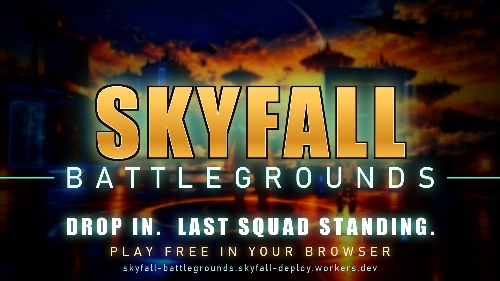

# Skyfall Battlegrounds: Trailer

A 41-second trailer for **Skyfall Battlegrounds**, a battle royale that runs in your browser: a floating-island map, squads of up to 4, bots filling every match to 50 fighters, and an in-game lobby with a store, armory, vault and draws.

**Play free:** https://skyfall-battlegrounds.skyfall-deploy.workers.dev

- File: `Skyfall_Battlegrounds_Trailer.mp4` (1920x1080, 30 fps, H.264 + AAC, about 53 MB)
- All footage was recorded from the game itself, one frame at a time: the floating islands, parachute landings, and a firefight with real headshots and kills, then edited with titles, colour grade and sound.
- Music: the game's own soundtrack, plus synthesised hits and effects.
